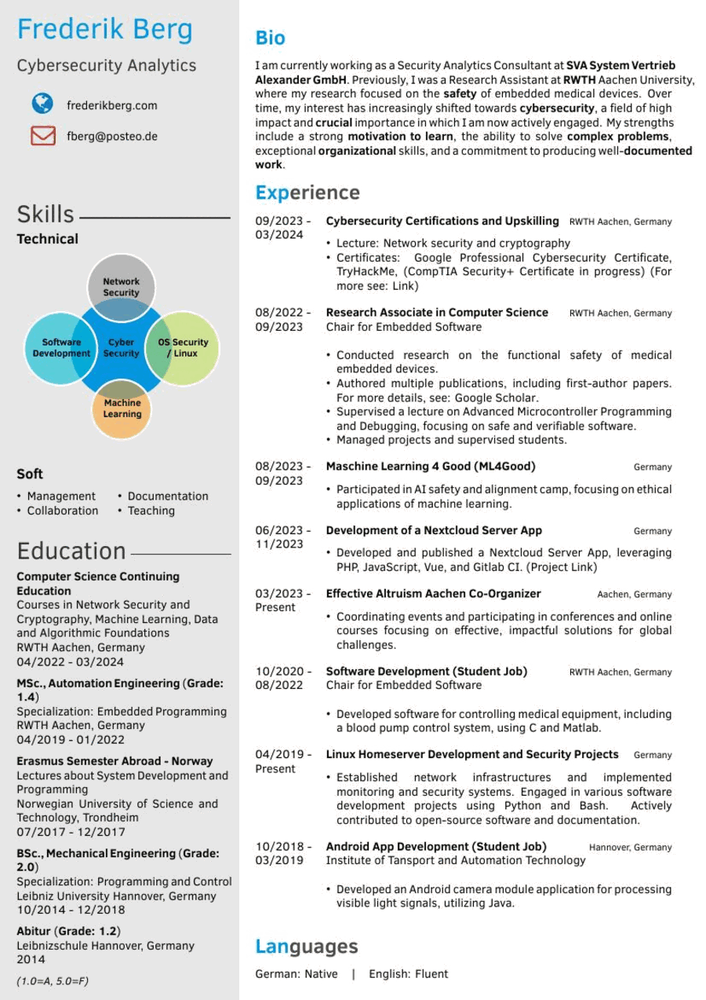

# CV

My CV, written in LaTeX. It is also a perfectly good starting point for your own — fork it, throw my content out, keep the layout.

**[→ cv.pdf](cv.pdf)** is the current build.



It is a one-page, two-column layout: a grey sidebar with contact details, a skill bubble diagram and education, and a main column with a short bio and a dated experience list. Everything lives in two files — `cv.tex` holds the content, `twentysecondcv.cls` holds the design. Almost certainly you only ever want to touch the first one.

## Use it in Overleaf

Easiest route if you would rather not install anything.

- Grab a ZIP of this repo: green **Code** button → **Download ZIP**
- In Overleaf: **New Project** → **Upload Project** → drop the ZIP in
- Open **Menu** (top left) and set **Compiler** to **XeLaTeX**

That compiler switch is not optional. The class loads fonts through `fontspec`, which pdfLaTeX cannot do — leave it on the default and you get a wall of errors before anything renders.

Overleaf's TeX Live already has every package this uses, so there is nothing else to install.

## Compile it locally

You need a TeX Live installation with `xelatex` and `latexmk`. Then:

```
make
```

That writes intermediate files into `build/` and copies the result to `cv.pdf`. Without `make`, the same thing by hand:

```
latexmk -pdfxe -interaction=nonstopmode -halt-on-error -output-directory=build cv.tex
```

On Debian or Ubuntu the packages `texlive-xetex`, `texlive-latex-extra`, `texlive-fonts-extra`, `texlive-pictures`, `texlive-pstricks` and `latexmk` cover it. If something is still missing, the error message names the exact `.sty` or `.cls` file it wanted, which is usually enough to find the package. A full TeX Live install is the option that requires no thinking.

Every pull request, every push to `main`, and a manual run of the `Build` workflow, also builds the PDF on GitHub Actions and attaches it to the run as a downloadable artifact, so you can get a fresh PDF without a local toolchain at all.

## Make it yours

Contact details sit near the top of `cv.tex` as a block of one-line commands — name, job title, email, website, phone, LinkedIn, GitHub, postal address. **Leave any of them empty and that line disappears from the sidebar**, so you are not stuck with a phone icon pointing at nothing.

The rest of the content is three blocks:

- `\education{...}` — free-form text for the sidebar. Plain paragraphs, `\textbf{}` for the degree line.
- `\skills` and `\soft{}{}{}{}` — the bubble diagram and the four soft-skill bullets. The diagram takes five labels; the `\\` inside each one is a manual line break, and the padding spaces around the words are how they get centred in their bubble.
- `\begin{twenty}` — the experience list. Each entry is a `\twentyitem` taking six arguments in order: start date, end date, role, location, sub-line (an employer or department, may be empty), and the body, usually an `itemize`.

Two things worth knowing before you rearrange much:

**The sidebar can overflow without complaining.** It is an absolutely positioned block, so if you add education entries until it runs past the bottom of the page, the extra content is silently dropped — no error, no warning, no second page. After editing the sidebar, look at the bottom of the PDF and check that the last line you expect is actually there.

**The main column flows normally**, so a longer experience list just spills onto page two. If you want to stay on one page, that is the part to trim.

## Credits

The design is the [Twenty Seconds CV](https://www.latextemplates.com/template/twenty-seconds-resume-cv) template by Carmine Spagnuolo, with modifications by Vel and Harsh Gadgil. MIT licensed, and so is this — see [LICENSE](LICENSE). Use it for whatever you like.

The original bundled Microsoft's Segoe UI as a font file. This copy uses Clear Sans Bold instead, which ships with TeX Live and Overleaf, so there is no font to install and nothing here that cannot be redistributed.
